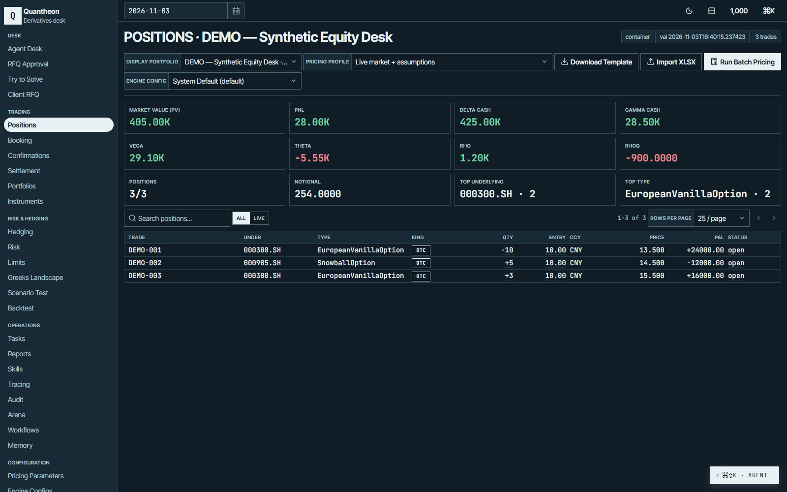
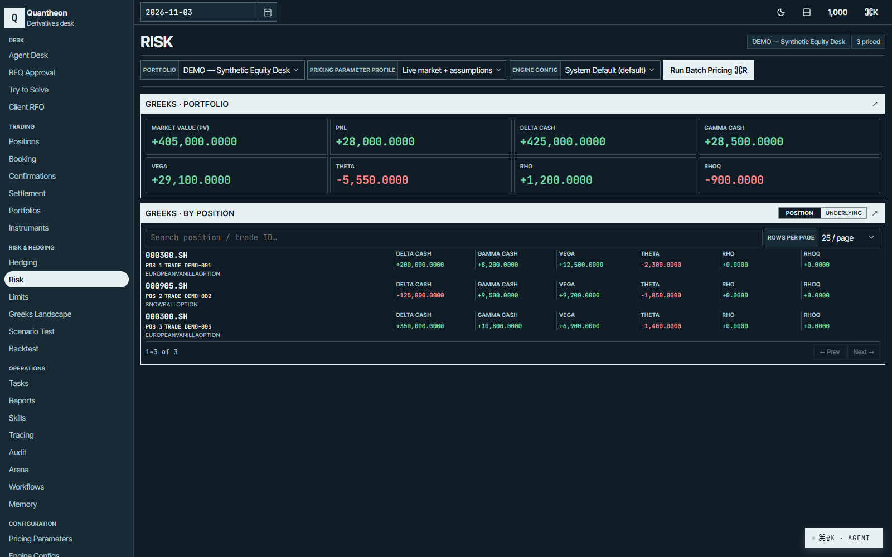
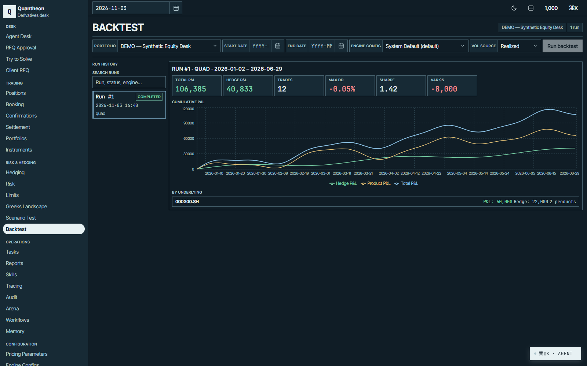
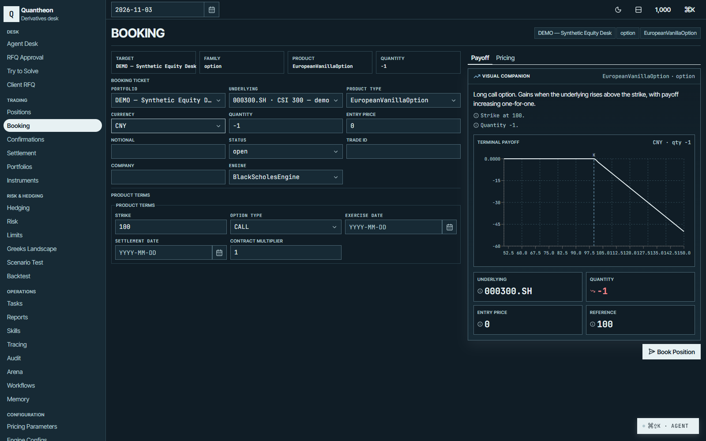

<div align="center">

# Quantheon

### Agentic derivatives pricing and hedging desk

**One workspace for pricing, risk, hedging and trade operations.**

From the first question to the next decision, keep the desk connected.

[Explore the desk](#the-workspace) · [Capabilities](#capabilities) · [Get started](#get-started) · [Architecture](#architecture)

[](pyproject.toml)
[](frontend/package.json)
[](LICENSE)

</div>

---

Quantheon brings conversational agents, deterministic quantitative tools and desk operations into a single interface. Build a trade, understand its contribution to the book, explore a hedge and follow the work through its lifecycle—without losing the context behind a decision.

> **A clear division of responsibility:** agents orchestrate the work; the bundled deterministic pricing engine performs pricing and risk calculations. Consequential actions have review and approval workflows, and write-class actions are recorded in an audit trail.

## The workspace

### See the book in context

Bring positions, valuations and portfolio-level exposure together. Filter the book, inspect individual trades and move from aggregate measures to position-level detail.



### Go deeper on risk

Review market value, P&L and Greeks across the portfolio, then examine the contribution of individual positions and underlyings.



### Explore how a hedge behaves

Review backtest runs alongside cumulative product, hedge and total P&L, with underlying-level detail available in the same workspace.



### Build a trade with its payoff in view

Enter product terms while viewing the associated payoff profile. The booking workspace keeps the trade ticket and visual context together.



*Figures in these screenshots are illustrative; the displayed valuations, Greeks and backtest series were seeded rather than calculated by the pricing engine.*

## Everything the desk needs, connected

| Capability | In the workspace |
| --- | --- |
| **Agent desk** | Describe a task in natural language and work with an agent that calls desk tools for pricing, risk, research and operations. |
| **Pricing & booking** | Build and price structured products, including vanilla and barrier options, autocallables, snowballs, phoenixes and Asian options. |
| **Portfolio risk** | Review Greeks and position-level exposures, run batch pricing and explore scenarios. |
| **Hedging** | Generate solver-assisted hedge proposals, inspect legs and residual exposure, and review historical backtests. |
| **Trade operations** | Manage RFQs, review extracted confirmation terms, track lifecycle events and work through settlement cashflows. |
| **Reporting & audit** | Generate templated reports grounded in desk data and inspect write-class actions and their approval history. |
| **Desk administration** | Configure pricing assumptions, instruments, engines, model channels, workflows and long-term agent memory. |
| **Messaging** | Connect the desk to Feishu/Lark through the optional gateway, including approval cards. |

The interface supports light and dark themes, comfortable and compact density, and a narrow-screen page selector.

## Get started

Set up the API and workspace locally in two terminals.

### Requirements

- Python 3.11+
- Node.js 20.19+ or 22.12+ and npm

### Start the backend

From the repository root:

```bash
python -m venv .venv
source .venv/bin/activate
python -m pip install -e ".[dev]"
cp .env.example .env
cp config/agent_channels.example.yml config/agent_channels.yaml
mkdir -p data artifacts
.venv/bin/python -m alembic upgrade head
.venv/bin/python -m uvicorn app.main:app --app-dir backend --reload --port 8000
```

On Windows, activate with `.venv\Scripts\activate` and use `.venv\Scripts\python` in place of `.venv/bin/python`.

### Start the workspace

In a second terminal:

```bash
cd frontend
npm install
npm run dev
```

Open **[localhost:5173](http://localhost:5173)**. The API is available on port 8000, with interactive documentation at [localhost:8000/docs](http://localhost:8000/docs).

### Configure the desk

- Put provider keys in `.env` and configure model channels in `config/agent_channels.yaml`. The local channel file is gitignored; `config/agent_channels.example.yml` is the tracked starting point.
- SQLite defaults to `data/open_otc.sqlite3`. Set `OPEN_OTC_DATABASE_URL` to choose another database, then run the Alembic migrations against it.
- Existing `OPEN_OTC_*` configuration names remain in place for compatibility.

## Architecture

```text
React workspace ── REST / streaming ── FastAPI + agent orchestration
                                            │
                              Bundled pricing engine + desk services
                                            │
                                  SQLAlchemy / SQLite
```

The React and Vite frontend communicates with FastAPI over HTTP and streaming responses. LangGraph-based agents coordinate desk tools, the bundled pricing engine handles quantitative calculations, and SQLAlchemy and Alembic manage persistence and schema upgrades. An optional Feishu/Lark gateway provides a messaging interface to the desk.

Quantheon Engine is included in `backend/quantheon_engine` and does not require a separate package installation. It incorporates Apache-2.0 licensed code; its copyright, license and notice are included alongside the source. Existing database, API and configuration field names are retained for compatibility.

## Development

```bash
# Backend
.venv/bin/python -m pytest

# Frontend
cd frontend
npm test
npx tsc --noEmit
```

See [CLAUDE.md](CLAUDE.md) and [frontend/CLAUDE.md](frontend/CLAUDE.md) for development conventions and operational safeguards. The [workflow guide](backend/app/golden_workflows/CLAUDE.md) covers the desk's evaluation manifests and fixtures.

## License

[GNU General Public License v3.0](LICENSE)
